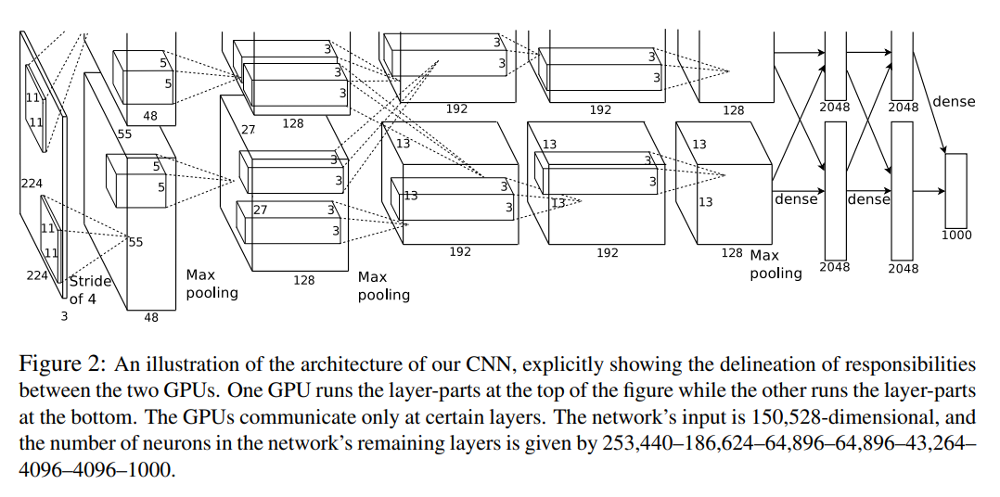

# AlexNet

- Paper: [ImageNet Classification with Deep Convolutional Neural Networks](https://proceedings.neurips.cc/paper_files/paper/2012/file/c399862d3b9d6b76c8436e924a68c45b-Paper.pdf), 2012
- Authors: Alex Krizhevsky, Ilya Sutskever, and Geoffrey E. Hinton

- Winner of ILSVRC-2012 (ImageNet classification)
- Demonstrated that deep CNNs can achieve strong performance on large-scale datasets

- Key contributions:
  - ReLU activation (faster training than tanh/sigmoid)
  - Model parallelism across two GPUs (split network with limited cross-connections)
  - Local Response Normalization (LRN)
    - Normalizes across nearby feature channels
    - Encourages competition between neurons
  - Overlapping pooling (kernel size > stride)
  - Extensive data augmentation:
    - Random cropping / translation
    - Horizontal reflection
    - PCA-based RGB color augmentation
  - Dropout in fully connected layers to reduce overfitting

- Architectural characteristics:
  - Large convolution kernel and stride in early layers (11x11, stride 4)
  - Large fully connected layers (dominant parameter count)

- Implementation: [cnn_study.models.alexnet.AlexNet](../src/cnn_study/models/alexnet.py)
  > The implementation is slightly adapted to a more modern architecture.
  > 
  > - Full connected CNN connection(for single GPU)
  > - Remove LRN(instead use optional batch normalization)