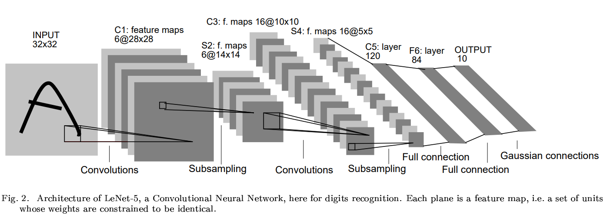

# LeNet-5

- Paper: [Gradient-Based Learning Applied to Document Recognition](http://yann.lecun.com/exdb/publis/pdf/lecun-98.pdf)
- Authors: Yann LeCunn, Leon Bottou, Yoshua Bengio, and Patrick Haffner

- One of the earliest successful Convolutional Neural Network (CNN) architectures

- Motivation:
  - Fully connected networks are inefficient for image data (too many parameters)
  - Exploits spatial structure of images

- Key Ideas:
  - Local receptive fields
  - Weight sharing (reduces parameters)

- Significance:
  - Demonstrated strong performance on handwritten digit recognition (MNIST)
  - Foundation of modern CNN architectures

- Impelmentation: [cnn_study.models.lenet.LeNet5](../src/cnn_study/models/lenet.py)

  > The implementation is slightly adapted to a more modern architecture.
  > 
  > - S2 -> C3 feature map fully connected
  > - Trainable Pooling => Fixed Pooling
  > - tanh activation => ReLU activation
  > - Optional batch normalization