# MnasNet

- Paper: [MnasNet: Platform-Aware Neural Architecture Search for Mobile](https://arxiv.org/abs/1807.11626), Jul 2018(v1) - May 2019(v3)

## Key Points

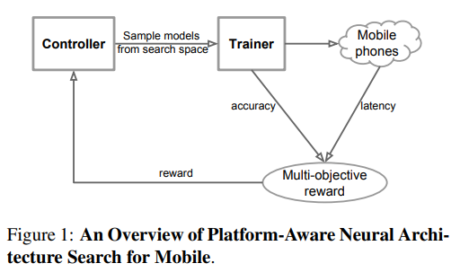

**Multi-objective**(accuracy + latency) **reward** 와 **factorized hierarchical search space** 를 활용하여 pareto optimal 한 모델 구조 탐색(NAS) 방법을 제안.

모델 구조 생성기(RNN 기반 모델 구조 확률 분포 생성기)를 PPO(Proximal Policy Optimzation)을 통해 강화학습.

> Pareto optimal: 최적의 accuracy - latency trade-off 를 갖는 구조. 즉, latency 희생 없이는 accuracy를 증가시키거나, accuracy 감소 없이 latency를 줄이는 것이 불가능한 상태.

### Multi-Object Reward

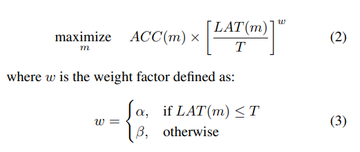

- FLOPs 대신 target device에서 inference latency 를 측정하여 이를 reward 에 직접 사용.
  > FLOPs 가 target device에서의 inference latency를 완전히 대표하지 못함.
- Latency `LAT(m)` 이 target latency `T` 이하인 조건에서 accuracy `ACC(m)` 을 최대화하는 일반적인 방식 대신 최적의 accuracy - latency trade-off(pareto optimal)를 갖는 여러 모델을 찾기 위해 이와 같이 latency 별 accuracy 에 weight를 주는 식을 reward로 사용.
- `α=0, β=-1` 로 주면 latency 가 `T`를 넘을 때만 패널티를 주고, `T` 이하일 때는 accuracy를 그대로 reward로 주는 hard constraint 방식.
- 저자는 latency가 2배 증가할 때 accuracy가 5% 증가된다는 경험에 근거하여 `α=β=-0.07` 로 설정
  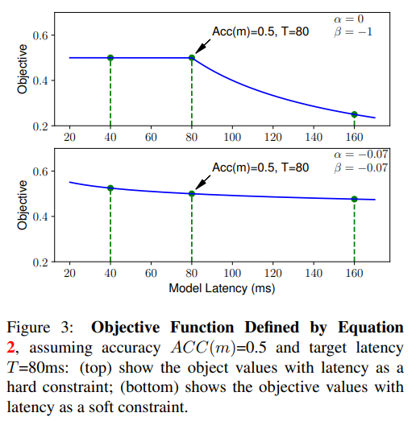

### Factorized Hierarchical Search Space

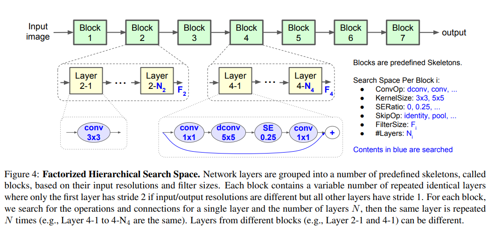

- 기존 cell-based NAS처럼 소수의 동일 cell을 전체 network에 반복하는 대신, network를 여러 block으로 나누고 block마다 서로 다른 layer 구조를 search하여 layer diversity를 확보. 동시에 하나의 block 내부에서는 동일한 layer를 반복시킴으로써 모든 layer를 독립적으로 search하는 경우보다 search space를 크게 줄임.
- Network의 전체적인 macro skeleton을 여러 개의 predefined block으로 고정해두고, 각 block 내부의 layer architecture와 반복 횟수를 search.
- 각 블록마다 다음의 sub search space를 가짐.
    - Convolutional ops: regular conv, depthwise conv, MBConv.
    - Convolutional kernel size: 3x3, 5x5.
    - SE(Squeeze-and-excitation) Ratio: 0, 0.25.
    - Skip ops: pooling, identity residual, or no skip.
    - Output filter size (MobilNetV2 대비 {x0.75, x1.0, x1.25})
    - Number of layers per block (MobilNetV2 대비 {-1, 0, +1})
- 각 block에서 input/output resolution이 달라지는 경우 첫 번째 layer만 stride=2, 나머지 반복 layer는 stride=1.

### Search Algorithm

- Search space의 모델 구조를 token list(sequence of actions) 에 매핑
- RNN 기반 controller는 모델 구조 생성기(token list의 확률분포 생성기)
- Search space에서 모델 샘플링 후 accuracy와 latency 측정
- PPO(Proximal Policy Optimization) 방식을 통해 reward의 기댓값이 최대가 되도록 RNN의 weights update
- RNN weights가 수렴 혹은 최대 반복 횟수 까지 이를 반복

#### Search Cost

- Search 단계에서 sampled model을 ImageNet에서 5 epochs만 학습하여 proxy accuracy 측정.
- 약 8K개의 architecture를 sampling.
- 64 TPUv2 에서 약 4.5 days/search.
- Latency는 Google Pixel 1 big CPU core에서 실제 측정.
- Top 15 models만 full ImageNet training.

## Experimental Results

### Imagenet Classifcation Performance

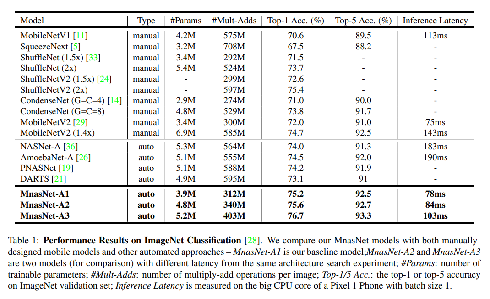

기존 mobile CNN 대비 전반적으로 더 우수한 accuracy-latency Pareto trade-off를 보임.

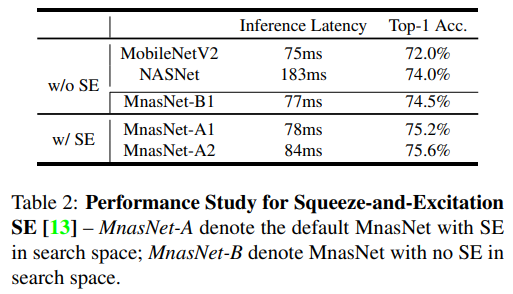

SE를 search space에 포함한 search에서 더 좋은 accuracy-latency trade-off의 모델을 발견했으며, SE를 search space에서 완전히 제외한 MnasNet-B1도 MobileNetV2/NASNet보다 우수한 trade-off를 보임.

### Model Scaling Performance

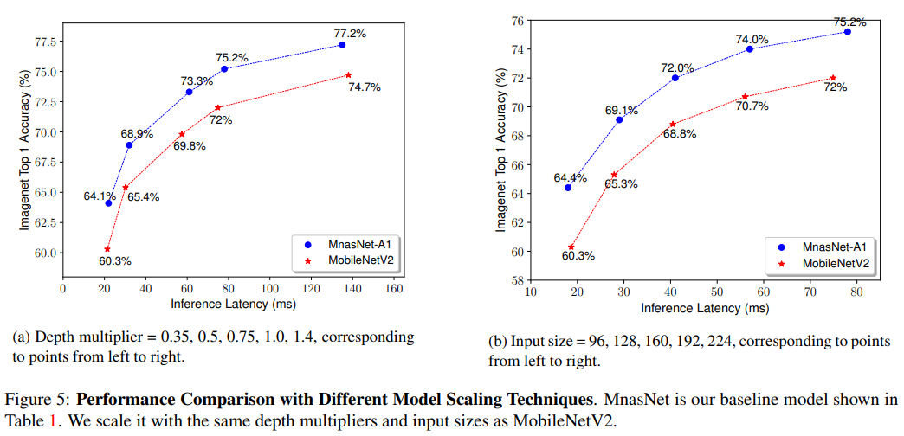

Depth multiplier 또는 input resolution을 줄이는 일반적인 model scaling에서도 MnasNet이 MobileNetV2보다 지속적으로 높은 accuracy를 보임.

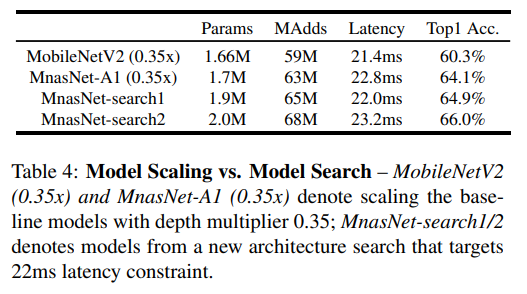

하지만 작은 latency target이 명확하다면 기존 모델을 단순 scaling하는 것보다 해당 latency target으로 architecture search를 다시 수행하는 것이 더 효과적.

### COCO Object Detection Performance

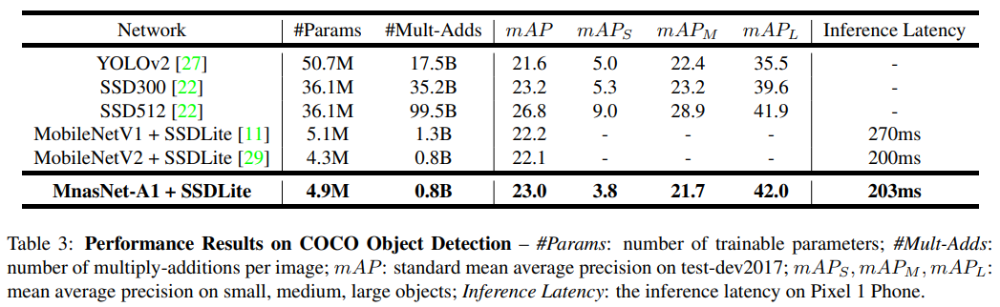

ImageNet classification에서만 좋은 성능을 보이는 것이 아니고, object detection에서도 좋은 성능을 냄.

### Soft vs. Hard Latency Constraint

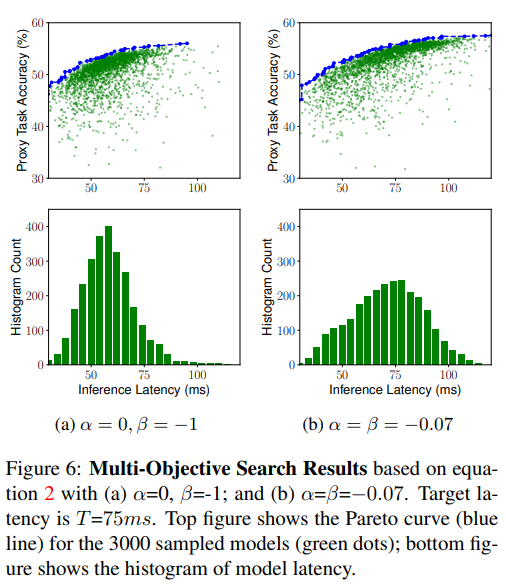

- Hard constraints(α=0, β=-1)는 T=75ms 초과 모델을 강하게 penalize하므로 controller가 빠른 모델 쪽에 집중.
- Soft constraint(α=β=-0.07)는 75ms 주변분 아니라 \<40ms, >110ms 영역도 탐색
- 따라서 한번의 architecture search에서 다양한 latency의 pareto-optimal model들을 얻을 수 있음.

### Disentangling Search Space and Reward

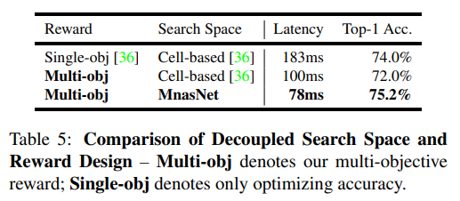

- Reward 만 바꿨을 때, latency가 183ms -> 100ms로 줄지만 accuracy는 2%p 감소.
- MnasNet search space까지 적용했을 때는 latency도 줄면서 accuracy도 증가함.
- Muti-objective reward 뿐 아니라 factorized hierarchical search space가 좋은 accuracy-latency trade-off 를 찾는데 중요한 역할을 하는 것을 알 수 있음.

### MnasNet Architecture and Layer Diversity

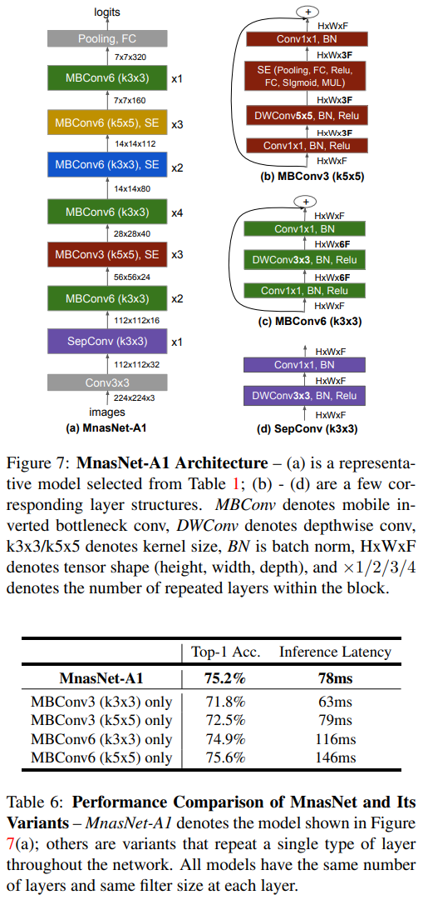

다양한 kernel size, expansion ratio 및 operation을 block별로 선택하는 layer diversity가 accuracy-latency trade-off에 중요함을 검증. 단순히 모든 block에 동일한 MBConv를 반복하는 것 보다 heterogeneous architecture가 효과적.