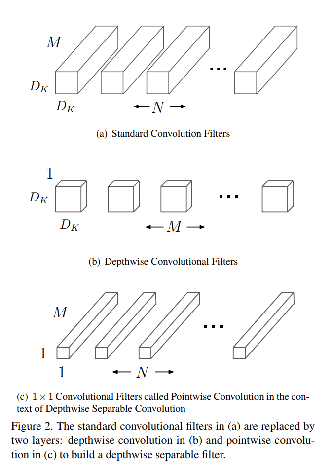
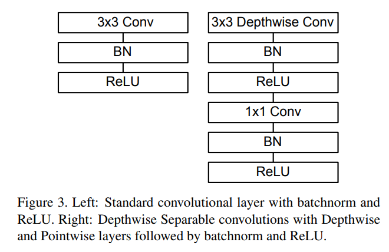

# MobileNet

- Paper: [MobileNets: Efficient Convolutional Neural Networks for Mobile Vision Applications](https://arxiv.org/abs/1704.04861), Apr 2017

- **Depthwise Separable Convolution** 구조를 기반으로 한 모바일/임베디드 환경을 위한
 효율적인 경량화 모델 구조 제안
  
  - 3x3 convolution 대신 channel 별(depthwise) 3x3 colvolution 과 1x1 convolution(pointwise) 으로 분리
  - 일종의 극단적인 factorized convolution
  - 3x3 depthwise convolution 에서는 filtering 만하고 pointwise 에서 channel 결합하여 새로운 feature 생성
  - 일반적인 3x3 convolution 대비 8-9배 적은 계산
  - 분리된 각각의 colvolution layer 뒤에 BN, ReLU 유닛
    
  - 첫 번째 층만 일반 3x3 convolution 사용하고, 마지막은 GAP 후 FC 사용

- Width multiplier, resolution multiplier hyper parameter 로 모델 크기 결정
  - **Width Multiplier**: 입출력 및 중간층의 채널 수를 결정(Thinner Models)
  - **Resolution Multiplier**: 입력 이미지의 크기(해상도) 조절(width/height)
  - 성능-연산량 trade-off 를 유연하게 조절 가능

- 획기적인 계산량 및 파리미터 수 감소 대비 비교적 경쟁력있는 성능을 보여줌
- ImageNet Classification, Object Detection, Geolocalization 등 다양한 task 에 대해서도 모델 크기/속도 대비 경쟁력 있는 성능을 보여줌
- Face Attribute Classification 실험에서 Distillation 학습을 적용하여 추가 정규화 없이도 높은 성능을 달성
  - Teacher 모델 대비 약 100배 이상의 계산량 절감과 유사한 정확도 달성

- Implementation: [cnn_study.models.mobilenet](../../src/cnn_study/models/mobilenet.py)