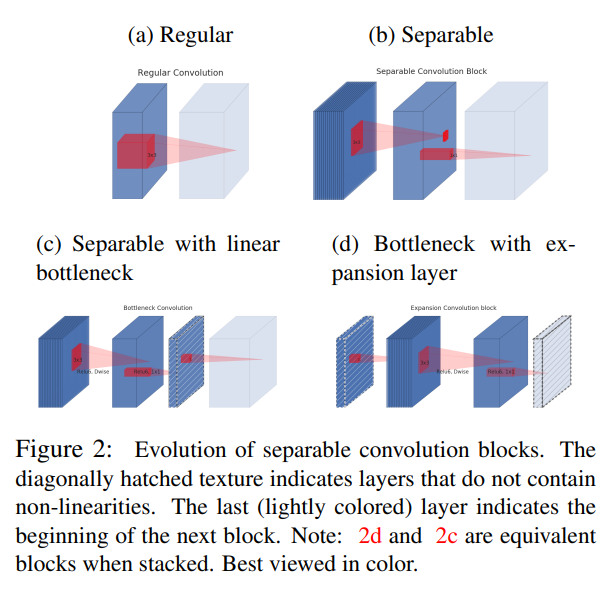
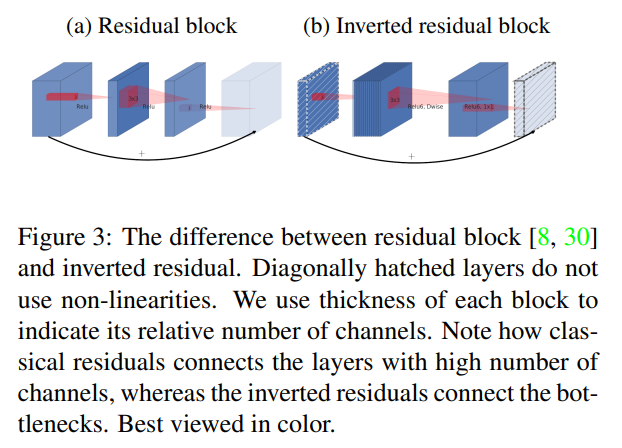
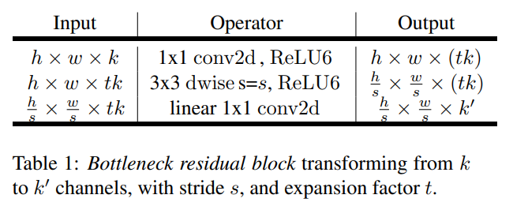
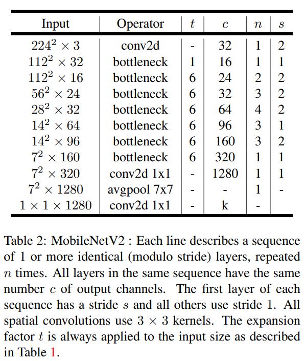

# MobileNetV2

- Paper: [MobileNetV2: inverted Residuals and Linear Bottlenecks](https://arxiv.org/abs/1801.04381), Jan 2018(v1) - Mar 2019(v4)

- Inverted Residual with Linear Bottlneck

  
  - Linear Bottleneck
    - 보통 d 차원(채널)의 정보는 "manifold of interest"를 형성한다고 보고, 저차원의 subspace로 embeding이 가능하다고 봄.
    - ReLU의 경우 non-zero value에 대해서는 입/출력이 동일하므로 해당 영역에서는 linear transformation으로 볼 수 있음.
    - 저차원의 bottlneck layer의 경우 압축된 형태로 ReLU와 같은 non-linearity activation 이 추가되면 필수적인 정보가 사라질 수 있어 non-linear activation을 제외.
    - 저자의 실험에서도 bottleneck 층에 non-linear activation을 없앴을 때 약간의 정확도 향상을 확인
  - Inverted Residual

    
    
    - 기존 ResNet의 bottlneck 구조는 Input -> Bottleneck(저차원) -> Output(+ Input Identity) 
    - MobileNetV2 에서는 Input Bottleneck -> Expansion Layer ->  Output Bottleneck(+ Input Identity) 으로 Bottleneck이 input/output 이 되고, 그 중간에 큰 차원의 layer 를 둠.
    - Expansion Layer 는 1x1 convolution 으로 expansion ratio 만큼 차원을 늘린 뒤, 3x3 depth-wise convolution 후 다시 1x1 covolution 으로 출력 차원 수를 맞춤.
    - Residual connection 이 expansion layer 가 아닌 bottleneck layer를 연결.
    - 마지막 1x1 convolution 은 non-lineary activation을 사용하지 않는 linear transformation.
    - Bottleneck layer는 정보를 저장하는 capacity를 담당하고, expanded layer는 비선형 변환을 수행하는 expressiveness를 담당.
    - Inverted Residual 형태가 기존의 residual bottleneck 보다 추론시 메모리를 덜 쓰도록 최적화 가능.

- 첫 layer에 regular full convolution 후 이후에 bottleneck block을 반복적으로 사용하여 모델 구성.
  

  - 첫 bottleneck layer를 제외하곤 모두 expansion ratio 6 사용
  - 실험 결과 expansion ratio 5~10 구간에서는 유사한 성능을 보였으며, MobileNetV2는 정확도와 효율성의 균형을 고려하여 expansion ratio 6을 채택.

- v1과 동일하게 resolution multiplier 와 width multiplier 로 accuracy-performance trade off 조절
- v1과 달리 width multiplier < 1 인 경우에는 마지막 1280-channel convolution layer는 축소하지 않음.(width multiplier > 1인 경우에는 확장)

- Implementation: [cnn_study.models.mobilenet](../../src/cnn_study/models/mobilenet.py)
  > 논문에서는 dropout 을 언급하지만 다른 구현과의 일관성을 위해 여기서는 생략함.