# NetAdapt

- Paper: [NetAdapt: Platform-Aware Neural Network Adaptation for Mobile Applications](https://arxiv.org/abs/1804.03230)
- ECCV 2018
- arXiv v1: Apr. 2018, v2: Sep. 2018

## Key Points

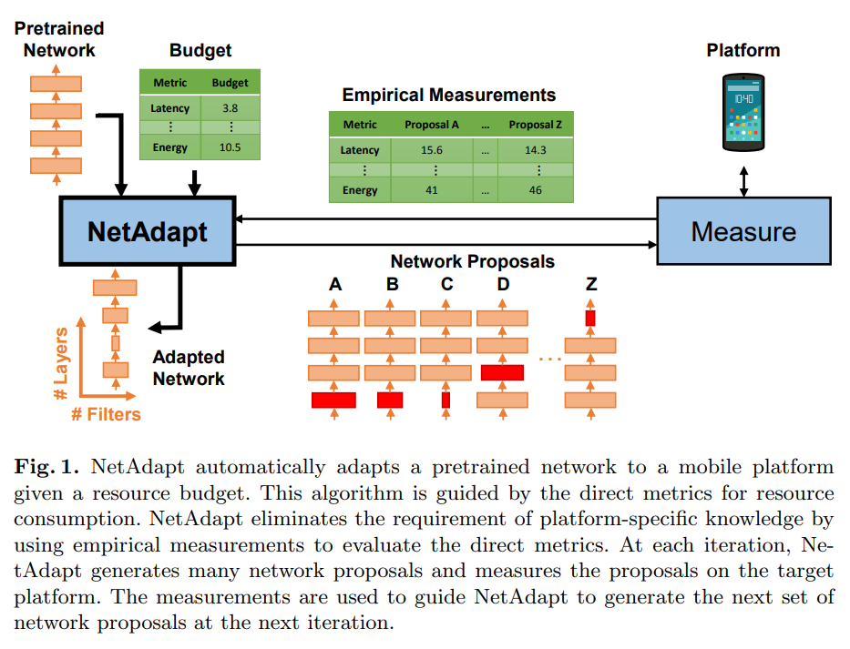

- 이미 학습된 deep neural network를 주어진 resource buget의 mobile platform에 맞도록 모델을 간소화(adaptation) 하는 방법
- 기존의 adaptation 방식에서 MACs와 같이 간접적인(indirect/proxy) metric을 사용하는 대신에 target platform(device)에서 직접 측정한 **latency**, **energy consumption**을 사용하여 adaptation 수행

## Algorithm

NetAdapt의 목적은 다음 1번식을 푸는 것.

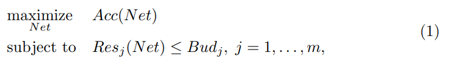

즉, 모든 resource budget(latency, energy consumption 등)을 만족하면서 최대한의 accuracy를 갖도록 모델을 간소화 시키는 것이 목적.

이를 달성하기 위해 다음 2번 식처럼 매 반복(iteration)마다 resource constraint를 이전 반복보다 조금씩 줄여가면서 최종적으로 resource budget을 달성할때까지 반복.

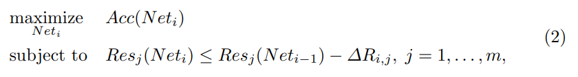

> `ΔR_i,j`는 j번 resource의 i번 iteration에서 요구하는 reduction 양으로, resource reduction schedule로 결정(cf. learning rate schedule)

각 iteration에서 이전 iteration에서 선택된 network를 기준으로, 각 CONV/FC layer를 하나씩 간소화한 K개의 proposal을 생성한다. 각 layer에 대해 현재 intermediate resource constraint를 만족하면서 보존할 수 있는 최대 filter 수를 찾고, 선택된 output filter와 다음 layer의 대응 input channel을 제거한다. 이후 각 proposal을 short-term fine-tuning하고, holdout accuracy가 가장 높은 proposal을 다음 iteration의 network로 선택한다.

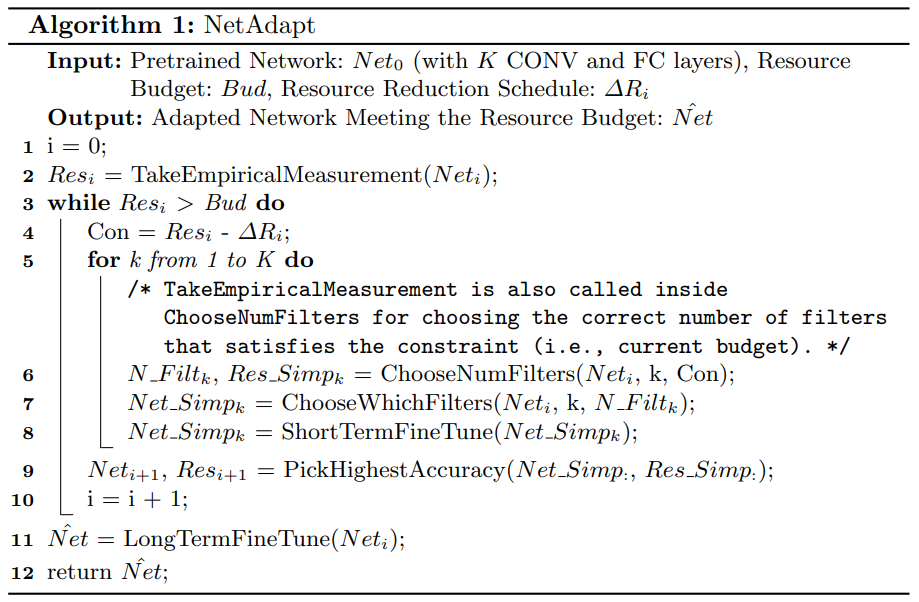

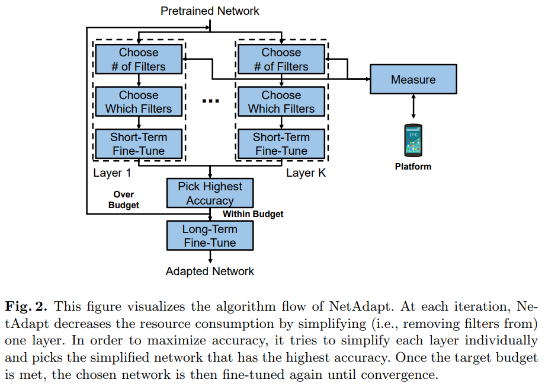

- 모든 network proposal을 adaptation 도중 target device에서 매번 실행하면 시간이 오래 걸리므로, layer의 input/output shape와 feature-map size별 direct metric을 target platform에서 미리 측정하여 layer-wise lookup table을 구축함. 알고리즘 실행 중에는 각 layer의 측정값을 합산하여 network 전체 resource consumption을 근사.
- `Choose Which Filters`는 필터의 L2 norm이 가장 큰 N개의 필터를 고름.(더 복잡한 채택 방식을 사용할 수 도 있음.)
- 각 iteration에서 proposal을 선택할 때 사용하는 accuracy는 ImageNet validation set이 아니라, training set에서 별도로 분리한 10,000장의 holdout set에서 측정.(최종 결과 accuracy는 ImageNet validation set으로 보고함.)

## Experiments

### Comparision with Benchmark Algorithms 

Multipliers, [MorphNet](https://arxiv.org/abs/1711.06798), [ADC](https://arxiv.org/abs/1802.03494)의 adaptation 알고리즘과 NetAdapt를 MobileNetV1을 대상으로 성능을 비교.

> Multipliers는 MobileNetV1 논문의 width multiplier, resolution multiplier로 모델 크기를 조정하는 방식을 의미. "50% MobileNetV1 (128)"은 MobileNetV1 에서 input image resolution 128에 50% width multiplier를 의미.

#### Adapting Small MobileNetV1 on a Mobile CPU

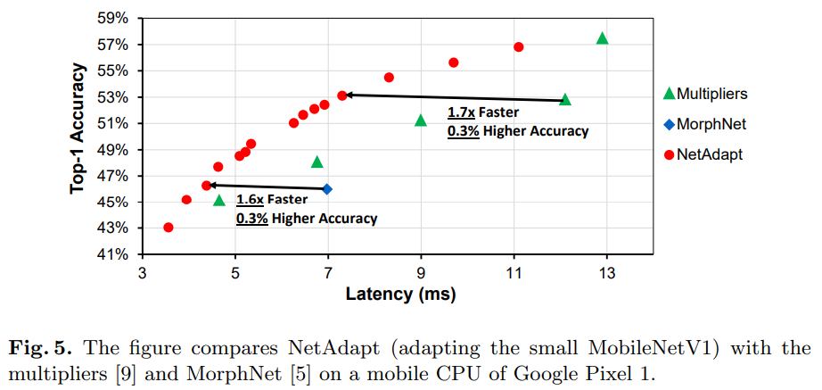

Small MobileNetV1("50% MobileNetV1 (128)")에 대해서 실험 시에 NetAdapt가 Multipliers, MorphNet 방식보다 mobile CPU에서 더 좋은 latency-accuracy trade-off를 보임.

#### Adapting Large MobileNetV1 on a Mobile CPU

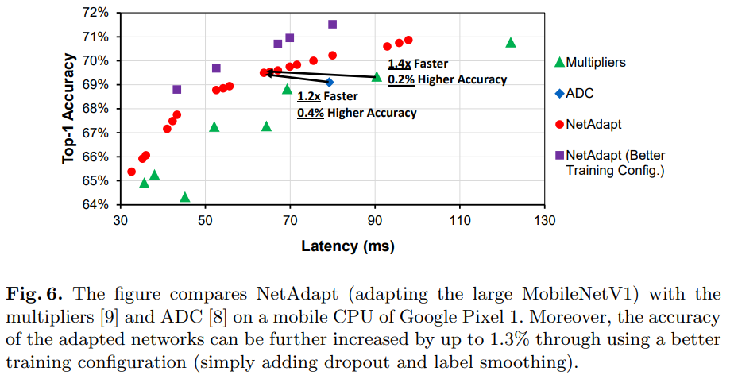

Large MobileNetV1("100% MobileNetV1 (224)")에 대해서 실험 시에 NetAdapt가 Multipliers, ADC 방식보다 mobile CPU에서 더 좋은 latency-accuracy trade-off를 보임.

#### Adapting Large MobileNetV1 on a Mobile GPU

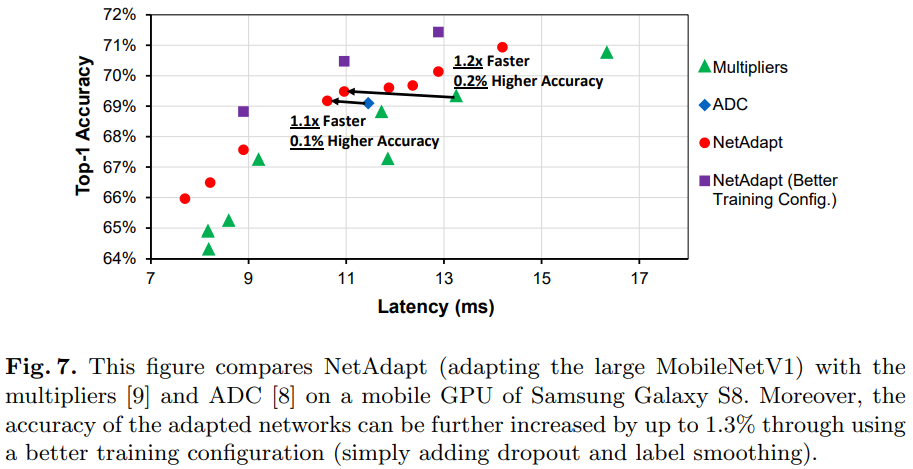

Large MobileNetV1("100% MobileNetV1 (224)")에 대해서 실험 시에 NetAdapt가 Multipliers, ADC 방식보다 mobile GPU에서 약간 더 좋은 latency-accuracy trade-off를 보임.

Mobile GPU 실험에서는 SNPE가 제공하는 layer-wise latency breakdown이 computation time만 포함하고 feature-map movement 등의 overhead를 포함하지 않아 lookup-table 추정 정확도가 낮았다. 또한 초기 network latency의 약 38%에 해당하는 6.2 ms의 non-reducible latency가 관찰되었다. 이 두 요인으로 mobile CPU 실험보다 개선 폭이 작았다.

### Ablation Studies

#### Impact of Direct Metrics

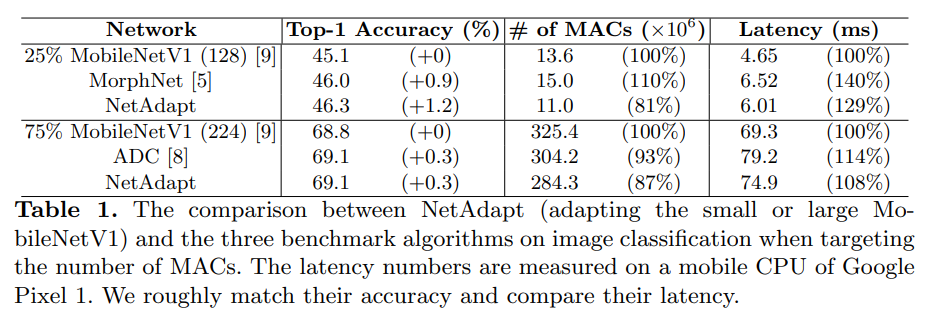

이 ablation에서는 latency 대신 MACs를 resource metric으로 사용하여 NetAdapt를 수행한다. NetAdapt는 비교 방법보다 낮은 MACs와 높은 accuracy를 얻었지만, MACs가 더 낮은 network가 실제 mobile CPU에서 반드시 더 빠르지는 않았다. 예를 들어 NetAdapt small model은 25% MobileNetV1보다 MACs는 19% 적지만 latency는 29% 높았다. 이는 실제 latency를 최적화하려면 MACs가 아니라 target platform의 direct metric을 사용해야 함을 보여준다.

#### Impact of Short-Term Fine-Tuning

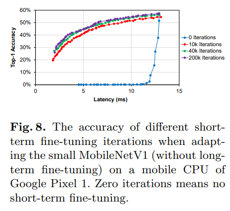

Short-term fine-tuning을 수행하지 않으면 adaptation이 진행되면서 accuracy가 거의 0까지 급락한다. 이 영역에서는 proposal 간 accuracy 차이가 noise에 지배되므로 잘못된 proposal을 선택할 가능성이 커진다. 10k iterations만 수행해도 accuracy가 20% 이상으로 유지되어 proposal을 더 신뢰성 있게 비교할 수 있으며, small MobileNetV1 실험에서는 40k iterations가 accuracy와 adaptation time 사이의 적절한 trade-off를 보였다.

#### Impact of Long-Term Fine-Tuning

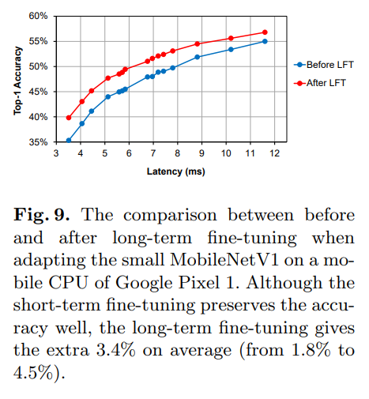

Short-term fine-tuning만 하여도 accuracy가 잘 보존되지만, 최종적으로 long-term fine-tuning 시 추가적으로 평균 3.4%p, 최대 4.5%p 정확도 향상을 보임.(short-term fine-tuing은 학습이 수렴하기에는 반복이 적으므로 놀라운 일은 아님.)

#### Impact of Resource Reduction Schedules

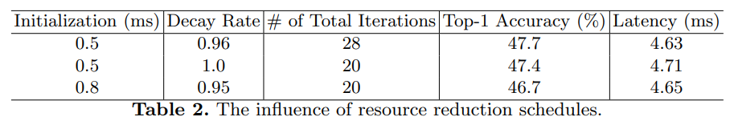

- Resource reduction을 크게 가져가면 adpation speed가 빠름(즉, 적은 반복으로 resource budget 달성).
- 같은 수의 반복을 할 때, 작은 초기값과 느린 decay(큰 decay rate)에서 더 좋은 정확도 보임.

### Analysis of Adapted Network Architecture

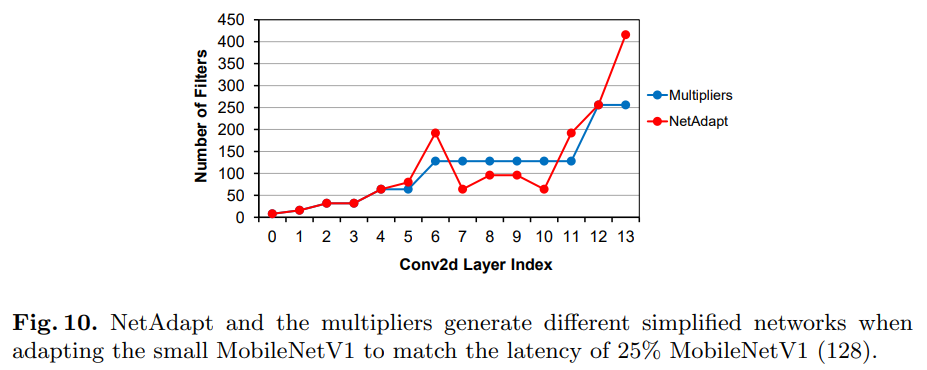

- NetAdapt는 multipliers보다 layer 7~10의 filter를 더 많이 제거하지만, spatial resolution이 감소하는 layer 6에서는 더 많은 filter를 유지함. 논문은 resolution 감소 지점에서 지나친 channel 감소로 information bottleneck이 생기는 것을 피하기 위해 더 많은 filter가 필요했을 가능성을 제시.
- 마지막 CONV layer인 layer 13에서는 multipliers보다 더 많은 filter를 유지한다. 논문은 ImageNet의 1,000개 class를 최종 FC layer가 구분하려면 마지막 feature map에 더 많은 feature channel이 필요할 수 있다고 추측.

### Adapting Large MobileNetV2 on a Mobile CPU

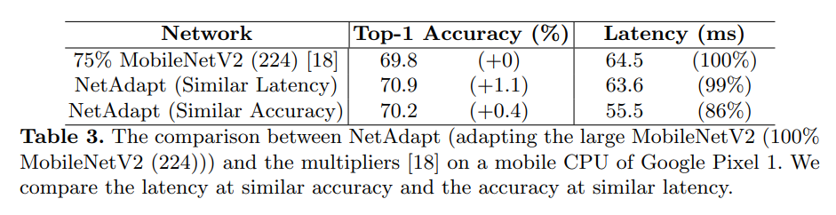

- MobileNetV2에서도 NetAdapt가 유효함을 확인.(더 나은 accuracy-latency trade-off 발견)
- MobileNetV2에서는 inverted residual bottleneck 구조로 adaptation 시 expasion layer를 줄이거나, 같은 resolution을 갖는 residual bottleneck의 channel을 함께 줄이는 방식으로 adaptation 진행.

## Notes

- NetAdapt는 전체 channel 조합을 exhaustive search하거나 global optimum을 보장하는 방법이 아님. 각 iteration에서 하나의 layer만 수정한 후보들을 비교하여 가장 높은 holdout accuracy를 갖는 후보를 선택하는 **progressive greedy search** 방식.
- Underlying platform/toolchain에 대한 이해 없이 hardware-specific architecture가 생성.