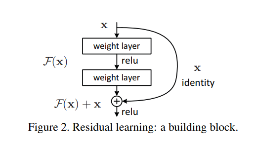
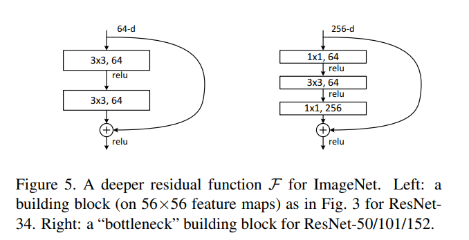

# ResNet

- Paper: [Deep Residual Learning for Image Recognition](https://arxiv.org/pdf/1512.03385), Dec 2015
- Authors: Kaiming He, Xiangyu Zhang, Shaoqing Ren, Jian Sun

- Winner of ILSVRC-2015 classification, detection, and localization tasks
- Winner of COCO-2015 detection and segmentation tasks

- Residual Learning 으로 Layer 가 깊어질 때 Optimization 이 어려워지는 degradation 문제 해결
  > **degradation**:
  >
  > 더 깊은 모델은 얕은 모델의 해를 포함할 수 있음.(추가된 layer가 identity mapping을 학습하면 되므로)
  >
  > 따라서 training error는 최소한 동일하거나 더 낮아야 하지만, 실제로는 깊어질수록 training error 자체가 증가하는 현상이 발생.
  >
  > => overfitting 이나 vanishing gradient 와는 다른 optimization difficulty 임.

  - 특정 레이어의 Output 에 Input 을 그대로(identity) element-wise addition 을 하는 Skip-connection 추가
  - `H(x) = F(x) + x` 에서, `H(x)` 를 학습하는 것보다 residual 인 `F(x)` 만 학습하는 것이 더 쉽다.
  (극단적으로 `H(x) = x` 를 찾아가야된다고할 때, `H(x) = x` 를 학습하는 것 보다 `F(x) = 0` 을 학습하는 것이 훨씬 쉽다.)
    > 입/출력 차원이 다를 때는 projection 을 추가(or zero padding)
    >
    > Shortcut options:
    > - A: Identity + zerro padding
    > - B: 차원이 늘때만 Projection shortcut(1x1 conv)
    > - C: 모든 shortcut connections 에 projection 추가

  - Bottleneck Block 사용
    - 더 깊은 ResNet-50, 101, 152 에서는 다음 변형 사용
      
    - 층을 늘리면서도 time complexity 유사

- 모든 Layer에 BatchNorm 적용

- Classifier 입력 전에 Global Average Pooling 사용(FC에서의 파라미터수 획기적 감소)

- Object Detection 에도 잘 동작 함
  - Faster R-CNN 에서 backbone 을 VGG => ResNet 으로 바꾸는 것만으로 큰 성능 향상을 보임

- Implementation: [cnn_study.models.resnet](../src/cnn_study/models/resnet.py)