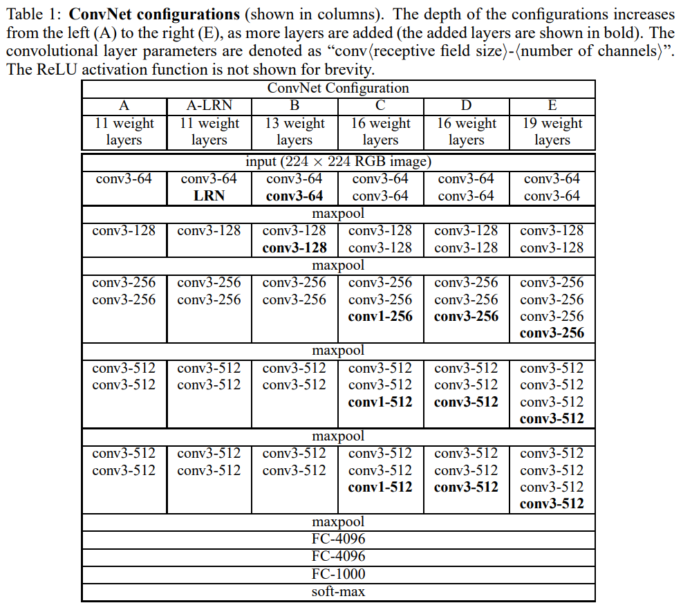

# VGG

- Paper: [Very Deep Convolutional Networks for Large-Scale Image Recognition](https://arxiv.org/pdf/1409.1556)
- Authors: Karen Simonyan & Andrew Zisserman

- ILSVRC-2014 first and second places in localisation and classification trakcs respectively

- Demonstrated that increasing network depth improves classification performance

- Used a simple and uniform architecture:
  - 3×3 convolutions (stride=1, padding=1)
  - 2×2 max pooling

- Showed that stacking small convolutions is more effective than using large kernels:
  - Three 3×3 convolutions ≈ one 7×7 receptive field
  - Fewer parameters
  - More nonlinearities

- Explored 1×1 convolutions as additional nonlinear transformations

- Showed no improvement by using LRN introduced from AlexNet

- Introduced multi-scale training(kind of augmentation) and advanced test-time evaluation:
  - Dense evaluation
  - Multi-crop evaluation
  - Multi-crop & dense evaluation

- Large fully connected classifier remained a major portion of model parameters

- Later architectures (e.g. ResNet) addressed optimization difficulties when scaling to much deeper networks

- Implementation: [cnn_study.models.vgg.VGG16/VGG19](../src/cnn_study/models/vgg.py)